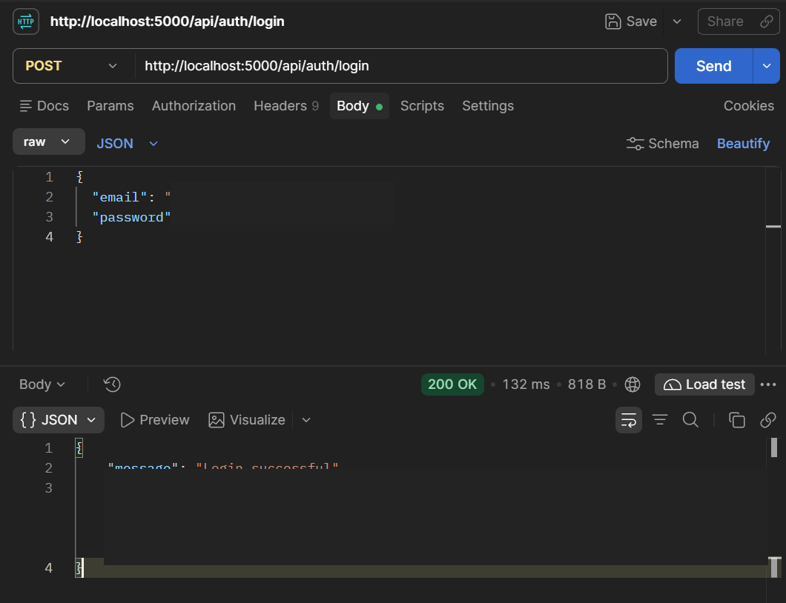
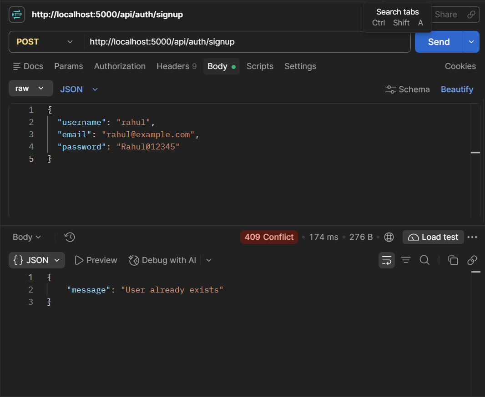
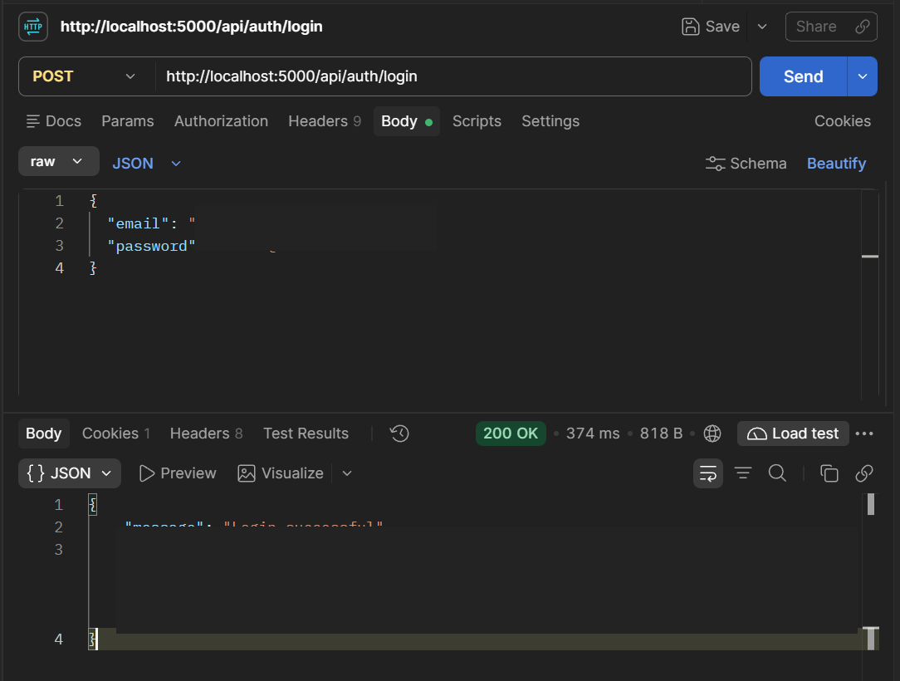
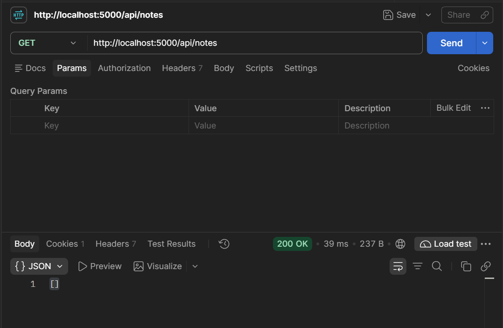
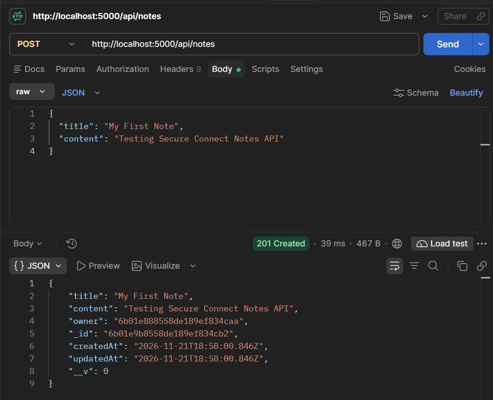
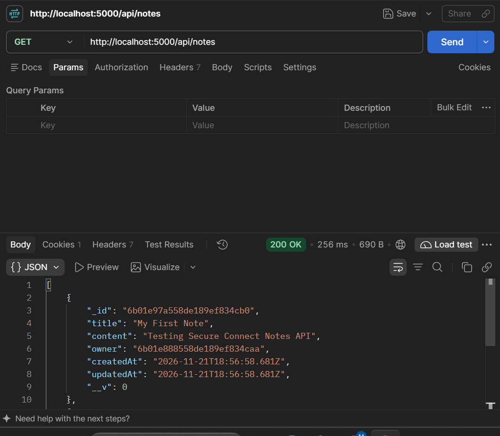
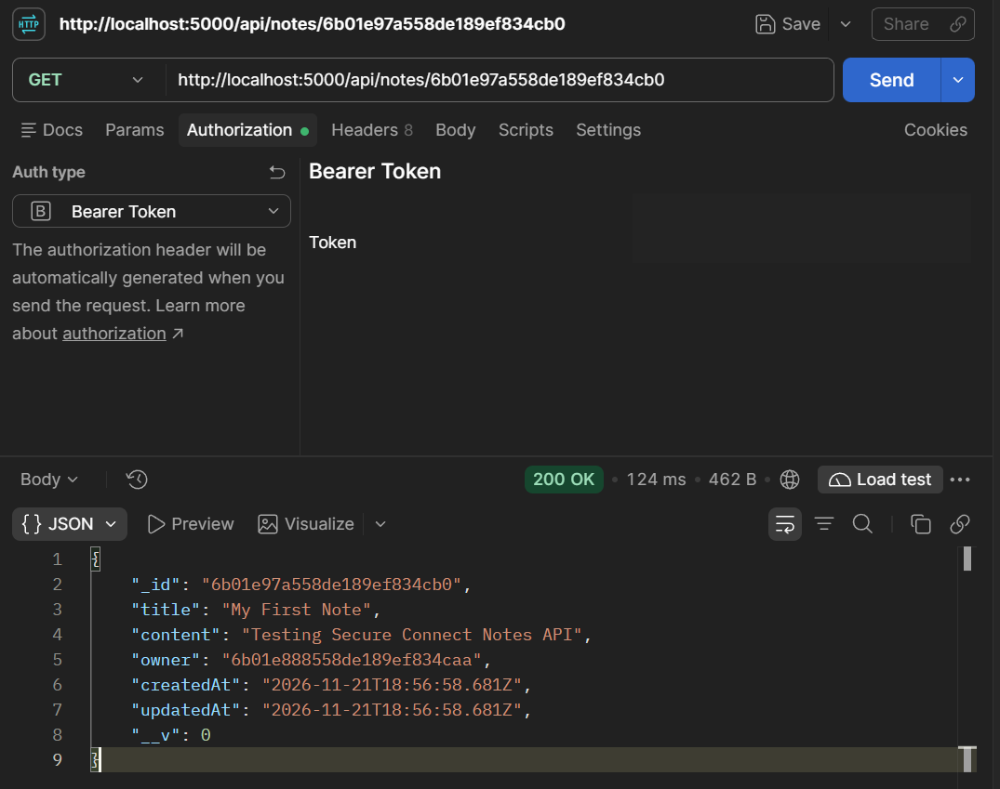
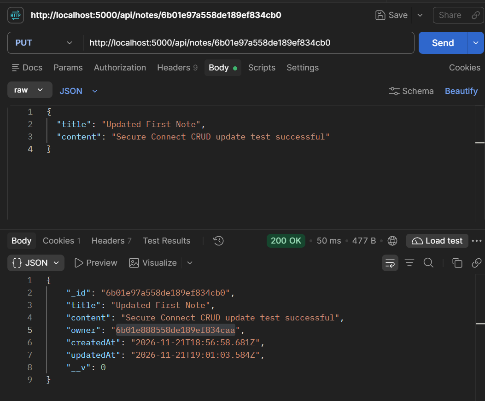
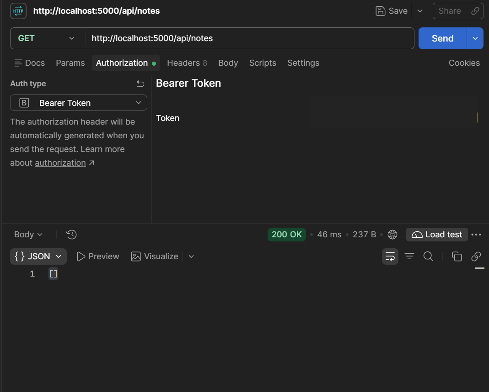

# Secure Connect and Communication Platform

A Node.js, Express, MongoDB, JWT, and Socket.IO application for secure user authentication, private notes, role-based admin operations, and real-time room-based chat. This repository contains the Lab 4 backend and a browser-based chat client.

## Features

- User signup and login with bcrypt password hashing
- JWT authentication using a bearer token or HTTP-only cookie
- Logout with authentication-cookie clearing
- Authenticated user profile endpoint
- Private notes CRUD; users can access only their own notes
- Role-based access control for admin endpoints
- Admin creation through a private local script; public signup cannot assign the admin role
- Real-time chat with authenticated Socket.IO connections
- Room and message validation, room limits, and per-socket rate limits
- Node.js EventEmitter events for account, login, and note activity
- Centralized JSON error handling
- Automated API and chat validation tests using Node's built-in test runner

## Tech stack

- Node.js 18.13+
- Express 4
- MongoDB and Mongoose 8
- JSON Web Tokens (`jsonwebtoken`)
- `bcrypt`
- Socket.IO 4
- Node.js built-in test runner

## Project structure

```text
.
├── config/
│   └── db.js
├── events/
│   └── appEvents.js
├── middleware/
│   ├── asyncHandler.js
│   ├── auth.js
│   └── errorHandler.js
├── models/
│   ├── Note.js
│   └── User.js
├── public/
│   └── index.html
├── routes/
│   ├── admin.js
│   ├── auth.js
│   ├── notes.js
│   └── profile.js
├── scripts/
│   └── createAdmin.js
├── socket/
│   ├── chat.js
│   └── validators.js
├── tests/
│   ├── api.test.js
│   └── chat.test.js
├── docs/
│   └── screenshots/
├── .env.example
├── .gitignore
├── app.js
├── package-lock.json
├── package.json
├── README.md
└── server.js
```

## Requirements

- Node.js 18.13 or later
- npm
- MongoDB (local instance or MongoDB Atlas)

## Installation and setup

1. Clone the repository:

   ```bash
   git clone https://github.com/MohitYadav-07/Secure-Connect-and-Communication-Platform-.git
   cd Secure-Connect-and-Communication-Platform-
   ```

2. Install dependencies:

   ```bash
   npm install
   ```

3. Create a local `.env` file:

   **Windows PowerShell**
   ```powershell
   Copy-Item .env.example .env
   ```

   **macOS / Linux**
   ```bash
   cp .env.example .env
   ```

4. Configure `.env`:

   ```env
   PORT=5000
   NODE_ENV=development
   MONGO_URI=mongodb://127.0.0.1:27017/secure_connect
   MONGO_URI_TEST=mongodb://127.0.0.1:27017/secure_connect_test
   JWT_SECRET=replace_with_a_long_random_secret
   JWT_EXPIRES_IN=1h
   ```

   Generate a strong secret:

   ```bash
   node -e "console.log(require('crypto').randomBytes(48).toString('hex'))"
   ```

   The test database name must contain `test`: the integration tests clear its user and note collections. Never point `MONGO_URI_TEST` at a development or production database.

5. Start the server:

   ```bash
   npm run dev
   ```

   Or:

   ```bash
   npm start
   ```

   After MongoDB connects, the API listens at `http://localhost:5000`. The chat demo page is served at `http://localhost:5000/`.

## Environment variables

| Variable | Purpose |
|---|---|
| `PORT` | HTTP server port (default: 5000) |
| `NODE_ENV` | Set to `production` when deployed over HTTPS |
| `MONGO_URI` | Main MongoDB connection string |
| `MONGO_URI_TEST` | Separate database used by integration tests; database name must contain `test` |
| `JWT_SECRET` | Secret used to sign and verify JWTs |
| `JWT_EXPIRES_IN` | JWT expiration duration (default: `1h`) |
| `ADMIN_EMAIL` | Email for the locally seeded admin |
| `ADMIN_USERNAME` | Username for the locally seeded admin |
| `ADMIN_PASSWORD` | Admin password; at least 12 characters and remove from `.env` after seeding |

## REST API documentation

Base URL: `http://localhost:5000`

Send JSON request bodies with `Content-Type: application/json`.

### Authentication

| Method | Endpoint | Access | Description |
|---|---|---|---|
| POST | `/api/auth/signup` | Public | Register a normal user |
| POST | `/api/auth/login` | Public | Login; returns JWT and sets cookie |
| POST | `/api/auth/logout` | Public | Clear the authentication cookie |

#### Sign up

**POST** `/api/auth/signup`

```json
{
  "username": "rahul",
  "email": "rahul@example.com",
  "password": "Rahul@12345"
}
```

Success: `201 Created`. Public signup always creates role `user`. Passing a `role` field cannot create an admin. Duplicate username/email returns `409 Conflict`.

#### Login

**POST** `/api/auth/login`

```json
{
  "email": "rahul@example.com",
  "password": "Rahul@12345"
}
```

Success: `200 OK` with `message` and a signed `token`. The server also sets a `token` cookie with `HttpOnly` and `SameSite=Strict`. In production it sets `Secure`; therefore use HTTPS.

Use the token on protected REST routes:

```http
Authorization: Bearer <JWT_TOKEN>
```

The server also accepts the `token` cookie. Do not share real JWTs in screenshots, README files, or public repositories.

#### Logout

**POST** `/api/auth/logout`

Clears the authentication cookie and returns a logout confirmation. Clients using bearer tokens should discard their locally held token too.

### Profile

| Method | Endpoint | Access |
|---|---|---|
| GET | `/api/profile` | Authenticated user |

Returns the current user's profile without the password hash.

### Notes

Every notes route requires a valid JWT. Each user can access only notes they own.

| Method | Endpoint | Description |
|---|---|---|
| POST | `/api/notes` | Create a note |
| GET | `/api/notes` | List the authenticated user's notes |
| GET | `/api/notes/:id` | Get one owned note |
| PUT | `/api/notes/:id` | Update an owned note |
| DELETE | `/api/notes/:id` | Delete an owned note |

Create note — **POST** `/api/notes`:

```json
{
  "title": "My First Note",
  "content": "Testing Secure Connect Notes API"
}
```

Success: `201 Created`. The owner is set from the authenticated token.

List notes — **GET** `/api/notes`: returns only notes belonging to the authenticated user.

Get one — **GET** `/api/notes/:id`: use the `_id` returned by create/list. Invalid IDs return `400`; missing or non-owned notes return `404`.

Update — **PUT** `/api/notes/:id`:

```json
{
  "title": "Updated First Note",
  "content": "Secure Connect CRUD update test successful"
}
```

Supply a non-empty `title`, `content`, or both. Success: `200 OK`.

Delete — **DELETE** `/api/notes/:id`: deletes the note only if it belongs to the authenticated user.

### Admin-only endpoints

A valid JWT with role `admin` is required.

| Method | Endpoint | Description |
|---|---|---|
| GET | `/api/admin/users` | List users without password hashes |
| GET | `/api/admin/notes` | List notes with owner username and email |

Normal users receive `403 Forbidden`.

#### Create an admin account

Public signup cannot create an admin. To seed an admin locally:

1. Set `ADMIN_EMAIL`, `ADMIN_USERNAME`, and `ADMIN_PASSWORD` in your private `.env`. The password must be at least 12 characters.
2. Run:

   ```bash
   npm run create-admin
   ```

3. Remove `ADMIN_PASSWORD` from `.env` after seeding.

### Real-time chat (Socket.IO)

Socket connections must authenticate using a valid JWT in the handshake:

```javascript
const socket = io("http://localhost:5000", {
  auth: { token: "<JWT_TOKEN>" }
});
```

Client events:

| Event | Payload | Description |
|---|---|---|
| `joinRoom` | `"general"` or room name | Join a room |
| `chatMessage` | `{ "room": "general", "message": "Hello" }` | Send a message to a joined room |
| `typing` | `{ "room": "general" }` | Notify other room members that the user is typing |

Server events:

| Event | Description |
|---|---|
| `system` | Room join notification |
| `chatMessage` | Broadcast chat message |
| `typing` | Typing notification to other room members |
| `chatError` | Validation, membership, or rate-limit error |

Implemented chat limits:

- Room names must match `[A-Za-z0-9_-]{1,30}`.
- A socket can join at most 5 rooms.
- Messages must be non-empty text and no longer than 500 characters.
- A socket can send up to 5 messages per 10 seconds.
- A socket can emit up to 10 typing events per 5 seconds.
- A socket must join a room before sending messages or typing.
- Socket authentication uses the REST API's JWT secret.

### EventEmitter activity events

`events/appEvents.js` logs these application events:

- `user:registered`
- `user:login`
- `login:failed`
- `note:created`
- `note:updated`
- `note:deleted`

## Testing

Run:

```bash
npm test
```

The project uses Node's built-in test runner. Chat validation tests do not require MongoDB. API integration tests need MongoDB and use `MONGO_URI_TEST` (default: `secure_connect_test`). The test suite clears users and notes before each test; use only a dedicated test database.

## Postman test evidence

These are screenshots from the supplied local test run. The login screenshots have been redacted to hide passwords and JWT values from the original captures.

> **Important security note:** The original screenshots visibly exposed bearer tokens and example passwords. Treat the original token as compromised and do not reuse it. The copies below have the sensitive areas obscured. Generate a fresh login token for future tests.

### 1. Login successful — `200 OK`



### 2. Duplicate signup rejected — `409 Conflict`

This is an expected conflict response because the user already exists; it is not a successful registration.



### 3. Login with existing user — `200 OK`



### 4. Notes list before creation — `200 OK`



### 5. Create note — `201 Created`



### 6. Notes list after creation — `200 OK`



### 7. Get note by ID — `200 OK`



### 8. Update note — `200 OK`



### 9. Subsequent notes-list request — `200 OK`



## Security notes

- Keep `.env` private and do not commit secrets.
- Use a long, random `JWT_SECRET`; do not use example values in production.
- Use HTTPS in production; the login cookie is marked `Secure` when `NODE_ENV=production`.
- Passwords are stored as bcrypt hashes.
- Public signup cannot assign the admin role.
- Notes queries are scoped to the authenticated user.
- Admin routes enforce role-based authorization.
- Never publish live JWTs, passwords, database connection strings, or session cookies.

## License

No license has been specified. Add a license file if you intend to grant reuse or distribution rights.
